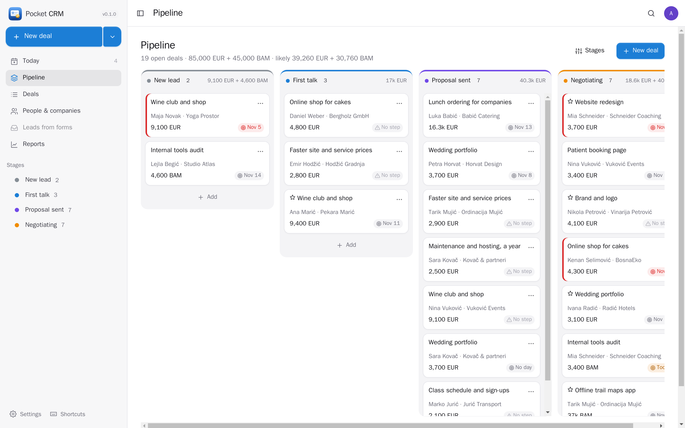
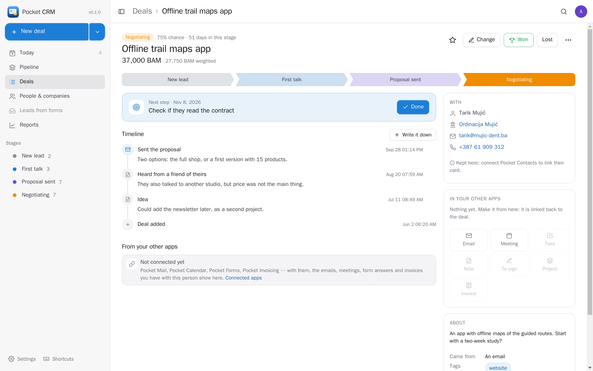
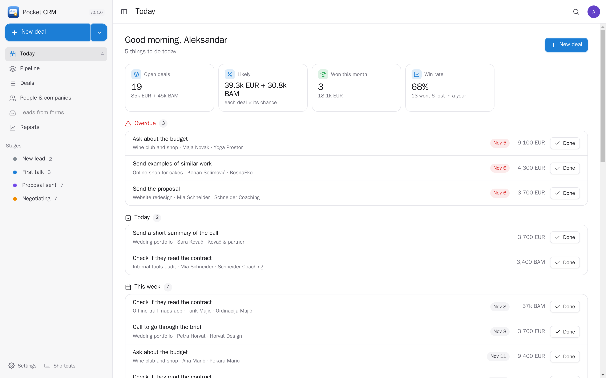
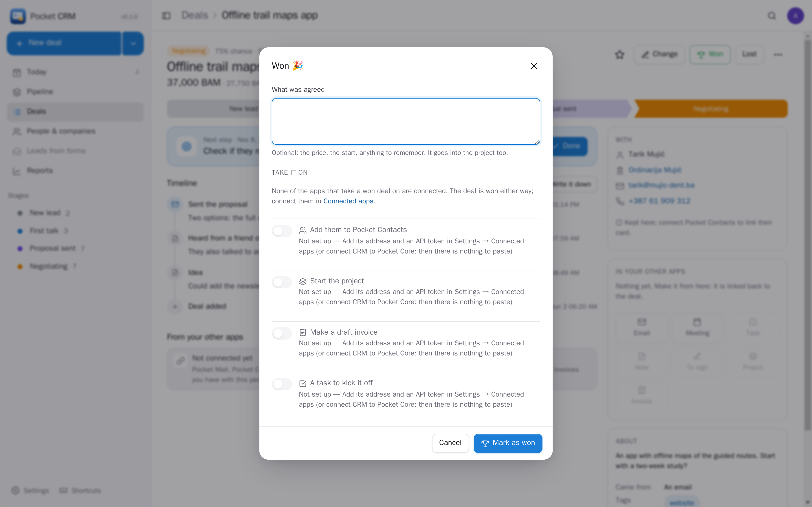
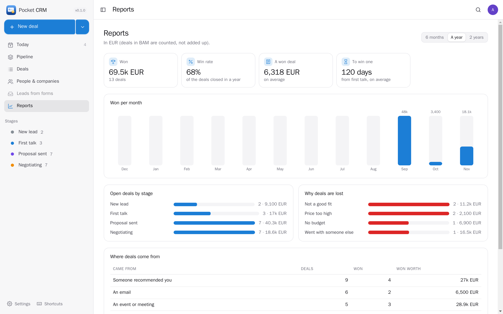
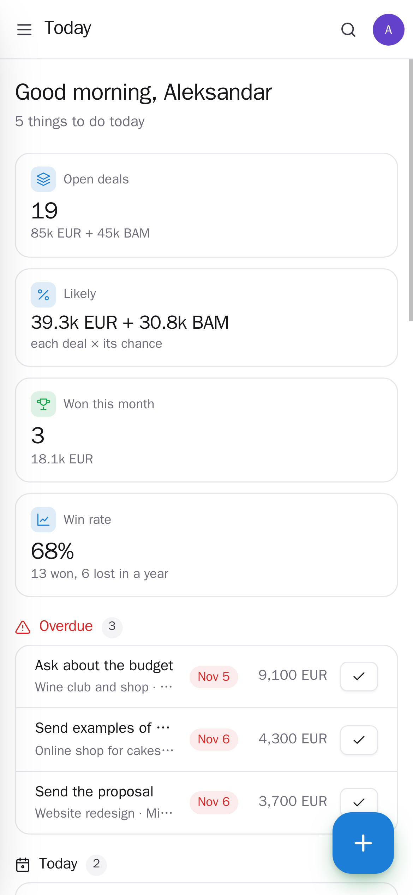
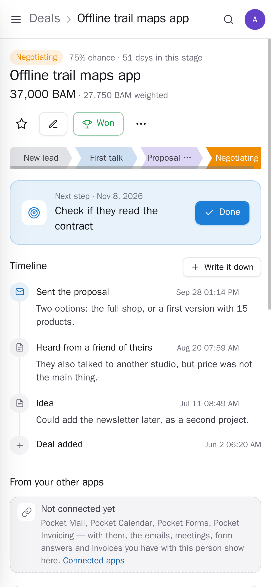

<p align="center"></p>
<h1 align="center">Pocket CRM</h1>
<p align="center">Your possible work, from the first talk to signed: deals on a board by stage, what each is worth, the next step and when, and everything that happened. Today shows what to do now and which deals went quiet; winning a deal starts the project and a draft invoice. Pick people from your contacts, see the emails and meetings you had with them, send a proposal to sign — through your other Pocket apps when they are there, on its own when they are not. Bring your deals from Pipedrive, HubSpot or a spreadsheet.<br>One Go binary, one SQLite file, one volume. Part of the Pocket apps; works on its own too.</p>
<p align="center">
  <a href="https://github.com/abjelosevic88/pocket-homelab-crm/actions"></a>
  <a href="https://github.com/abjelosevic88/pocket-homelab-crm/pkgs/container/pocket-homelab-crm"></a>
  <a href="LICENSE"></a>
</p>

---

<p align="center"></p>

<table>
  <tr>
    <td width="50%"></td>
    <td width="50%"></td>
  </tr>
  <tr>
    <td align="center"><sub>A deal: the stage, the next step, the timeline, who it is with and what it has in your other apps.</sub></td>
    <td align="center"><sub>Today: steps overdue and due, deals gone quiet, what closes soon, what was won.</sub></td>
  </tr>
  <tr>
    <td width="50%"></td>
    <td width="50%"></td>
  </tr>
  <tr>
    <td align="center"><sub>Won: start the project, a draft invoice and a kick-off task — each only if its app is connected.</sub></td>
    <td align="center"><sub>Reports: won per month, the open deals by stage, why deals are lost, where they come from.</sub></td>
  </tr>
  <tr>
    <td width="50%"></td>
    <td width="50%"></td>
  </tr>
  <tr>
    <td align="center"><sub>On the phone: what to do today, one tap to mark a step done.</sub></td>
    <td align="center"><sub>A deal on the phone.</sub></td>
  </tr>
</table>

## What it does

- **Deals**: what it is, who it is with (person, company, email, phone), what it is worth in any currency, the chance it is won, when it should close, where it came from, tags, a description.
- **A pipeline you set up**: your own stages with a colour and a chance each; drag cards between columns, or onto Won and Lost. Totals per column and a “likely” total (each deal × its chance).
- **Always a next step**: every open deal has one with a day. Today lists them — overdue, today, this week — with one tap for “done” and the step after it. Deals with no step and nothing for a while are listed as gone quiet.
- **A timeline** per deal: calls, meetings, emails, notes, steps done, moves between stages, won and lost, and what was made in your other apps.
- **Won and lost**: winning asks what was agreed and takes it on; losing asks why (your own list of reasons) so Reports can tell you.
- **People & companies**: everyone you have deals with, what is open, what was won, when you last talked.
- **Reports**: won per month, win rate, a won deal on average, days to win one, open deals by stage, why deals are lost, where the good ones come from.
- **Pocket AI** (optional, per deal, only when you press it): a next step from the timeline, where the deal stands in a few lines, a follow-up email.
- **Bring deals in** from Pipedrive, HubSpot, Zoho, Excel or Google Sheets (CSV), or a Pocket CRM export — twice is the same as once. Export everything as JSON or CSV.
- **Everyone their own** on one box: each person has their own pipeline, deals, settings and connections; admins see no one else's deals.
- **A morning note** through Apprise, ntfy or a webhook: the next steps due today and the deals gone quiet.

## Run it

```sh
docker run -d --name pocket-crm -p 8080:8080 -v ./data:/data \
  -e BASE_URL=https://crm.example.com -e SECURE_COOKIES=true \
  ghcr.io/abjelosevic88/pocket-homelab-crm:latest
```

or `docker compose up -d` with [docker-compose.yml](docker-compose.yml). Open it, create the first account and add a deal. All options: [docs/configuration.md](docs/configuration.md). API: [docs/api.md](docs/api.md).

## With Pocket Core

Set `CORE_URL` and `CORE_REGISTRATION_KEY` and CRM joins the box: people sign in with Pocket Core, Pocket AI helps, and through app links each deal reaches the person's own Pocket apps with nothing to paste:

| App | On a deal | Without it | Scopes |
|---|---|---|---|
| Pocket Contacts | pick the person and company from your contacts, add new ones, open their card | the deal keeps their name, email and phone | `contacts:read`, `contacts:write` |
| Pocket Mail | the emails you exchanged with them; follow-ups from your own mailbox | the email opens in your own email app and goes on the timeline | `mail:read`, `mail:send` |
| Pocket Calendar | plan a meeting; the meetings you had with them | the meeting downloads as a calendar file | `calendar:read`, `calendar:write` |
| Pocket Tasks | a task for a step, or every next step mirrored (ticked there = done here) | steps live here | `tasks:read`, `tasks:write` |
| Pocket Notes | the deal and its timeline as a note | — | `notes:write` |
| Pocket Sign | a proposal or contract from your templates; the deal shows when it is signed | — | `signing:read`, `signing:write` |
| Pocket Projects | the project, when a deal is won | — | `projects:read`, `projects:write` |
| Pocket Invoicing | a draft invoice when a deal is won; their invoices and what is paid | — | `invoices:read`, `invoices:write` |
| Pocket Forms | answers to your forms become leads in one click | add leads by hand | `forms:read` |
| Pocket AI | next step, summary, follow-up email; the Ask button on every page | your own OpenAI key, or no AI | inference |

**Nothing depends on another app.** Each app's state is checked per person — connected, switched off here, switched off in Pocket Core, not on this box, too old — and what needs it is shown greyed out with one line saying why and what to do, never hidden. When winning a deal, each step runs on its own, so a missing app never stops the win.

Other apps use your deals through `crm:read` and `crm:write`: Pocket Contacts shows a person's deals on their page, Pocket Forms and Pocket Mail turn an answer or an email into a lead (never twice), Pocket Day writes what happened into your journal, Pocket Search finds deals, Pocket AI tells you what is due and adds leads when you ask. Events on the bus — `crm.deal_created`, `crm.deal_moved`, `crm.deal_won`, `crm.deal_lost`, `crm.steps_due` — start flows in Pocket Flows. Without Core every connection can be made directly with a URL and a token; the Core-only choices stay visible, greyed out.

## Develop

```sh
make dev     # API on :8080 with demo data + Vite on :5173
make test    # go vet, go test, tsc
make         # web + binary
```

`node scripts/screenshots.mjs` takes the screenshots above from a demo instance and fails on any browser error. MIT licensed.
